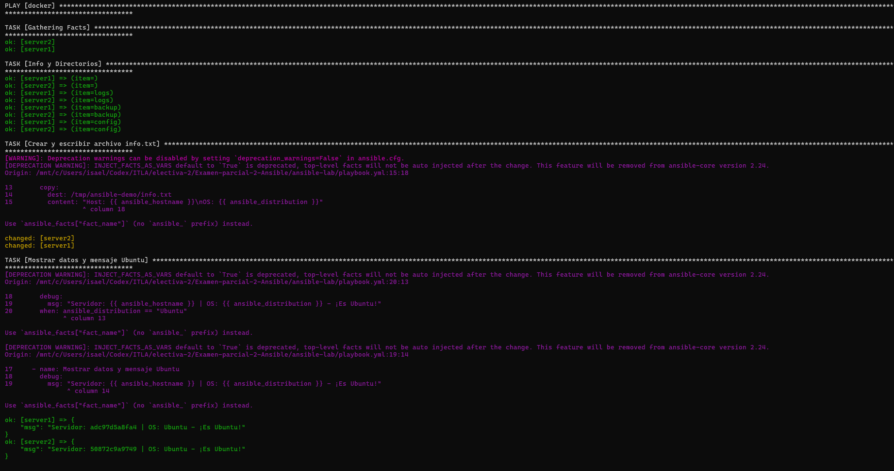

# Laboratorio Ansible con Docker

## Estructura
```text
ansible-lab/
├── docker-compose.yml
├── inventory.ini
├── playbook.yml
└── README.md
```

## Ejecución

1. **Iniciar los servidores Docker:**
   ```bash
   docker compose up -d
   ```

2. **Instalar Python en los contenedores:**
   ```bash
   docker exec -it server1 bash -c "apt update && apt install -y python3"
   docker exec -it server2 bash -c "apt update && apt install -y python3"
   ```

3. **Verificar la conexión con Ansible:**
   ```bash
   ansible docker -i inventory.ini -m ping
   ```

4. **Ejecutar el Playbook:**
   ```bash
   ansible-playbook -i inventory.ini playbook.yml
   ```

   